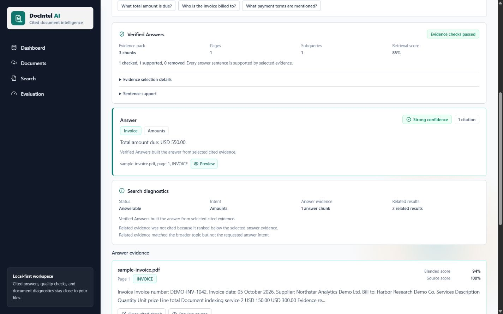
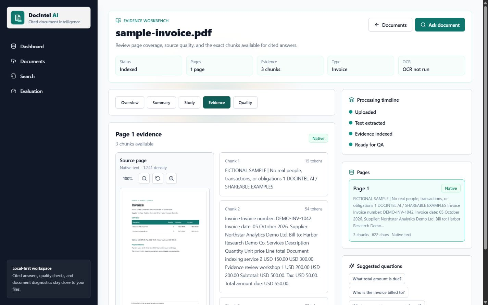
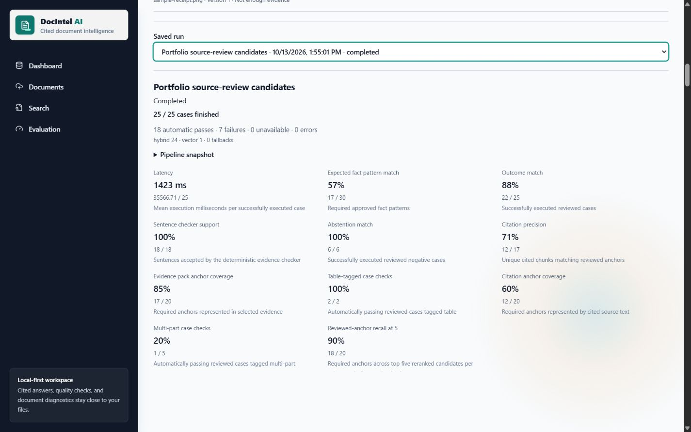
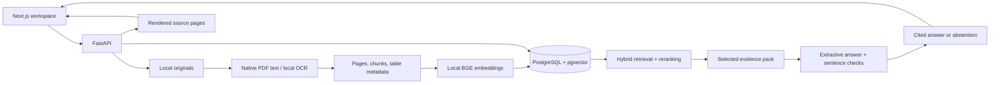
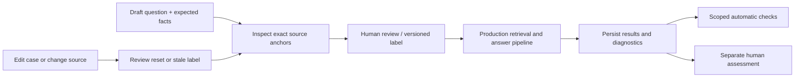

# DocIntel AI

**A local-first document workspace for cited answers, study material, and source-reviewed evaluation.**

[](https://github.com/nigelcheong1/docintel-ai/actions/workflows/ci.yml)

Upload a PDF or image, inspect what was extracted, and ask questions with page-level evidence.
DocIntel AI connects ingestion, hybrid retrieval, cited answers, and a persistent evaluation
workflow in one full-stack application. It can run without paid AI APIs.

[Quick Start](#quick-start) | [Demo](#demo) | [Architecture](#architecture) | [Evaluation](#evaluation) | [Limitations](#limitations)



## Demo

[Watch the captioned walkthrough](docs/demo/walkthrough.mp4) or [run the safe sample workspace](demo/README.md).
The walkthrough is assembled from actual app screens, not a continuous screen recording.

| Document Workbench | Evaluation Lab |
| --- | --- |
|  |  |

The shareable pack includes a public research paper, a NIST technical report, and original
fictional invoice, agreement, resume, and receipt examples. The receipt is an image-only OCR
input. [Source/version/license notices and checksums](demo/sources.json) accompany the pack.
**No personal enrolment letter or personal resumes appear in the demo.**

## What It Does

| Workflow | Implemented Behavior |
| --- | --- |
| Upload and inspect | PDF/PNG/JPG/JPEG upload, native text extraction, optional local OCR, processing status, parse-quality diagnostics, rendered page previews |
| Ask with evidence | Document-scoped hybrid lexical/vector retrieval, heuristic reranking, evidence packs, page/chunk citations, explicit fallback diagnostics |
| Verified Answers | Multi-part query decomposition, extractive answer construction, deterministic sentence support checks, abstention when selected evidence is insufficient |
| Summarize and study | Cited summaries, study questions, answer feedback, generation modes, and preview-before-replace controls |
| Review and measure | Persistent benchmark suites, versioned cases, source anchors, required-field review gates, cancellable runs, saved results, and separate human assessments |
| Inspect structured content | Heuristic table/row/cell extraction and page-image metadata, with source previews for checking imperfect extraction |

## Tech Stack

| Layer | Technology | Role |
| --- | --- | --- |
| Frontend | Next.js 16, React 19, TypeScript | Workspace, search, source viewer, study tools, and evaluation UI |
| UI | Tailwind CSS, Lucide | Responsive layout and accessible controls |
| Backend | FastAPI, Pydantic | Typed HTTP APIs and background processing |
| Persistence | PostgreSQL 17, pgvector, SQLAlchemy, psycopg | Documents, chunks, 384-dimensional embeddings, study artifacts, and benchmark history |
| PDF | PyMuPDF | Native text extraction and page rendering |
| OCR | Tesseract, Pillow | Local image/scanned-page recognition and preprocessing |
| Embeddings | sentence-transformers, `BAAI/bge-small-en-v1.5` | CPU-compatible semantic retrieval |
| Generation | Local heuristic provider; optional Groq | Summary/question generation and study feedback |
| Verification | pytest, Vitest, Testing Library, ESLint, TypeScript | Backend/frontend regressions and build checks |
| Infrastructure | Docker Compose, GitHub Actions | Local database and CI |

No fine-tuning, hosted vector database, or GPU is required. The default local generation
provider is heuristic, **not an on-device chat LLM**. Verified Answers uses extractive evidence
and deterministic checks, not Groq or an LLM entailment judge.

## Quick Start

Requirements: **Python 3.11/3.12, Node.js 24, Docker**, and optional Tesseract for OCR.
Run these commands from a fresh checkout; do not overwrite an existing configured `.env`.

```powershell
git clone https://github.com/nigelcheong1/docintel-ai.git
cd docintel-ai
Copy-Item .env.example .env
docker compose up -d
```

In a backend terminal:

```powershell
cd apps/api
python -m venv .venv
.\.venv\Scripts\python.exe -m pip install -r requirements.txt
.\.venv\Scripts\python.exe -m uvicorn app.main:app --host 127.0.0.1 --port 8000 --reload
```

In a frontend terminal, starting at the repository root:

```powershell
cd apps/web
npm ci
$env:NEXT_PUBLIC_API_BASE_URL = "http://127.0.0.1:8000"
npm run dev -- --hostname 127.0.0.1 --port 3000
```

Open [the app](http://127.0.0.1:3000), [API documentation](http://127.0.0.1:8000/docs), or
[the health endpoint](http://127.0.0.1:8000/health). First embedding-model initialization
may download model weights and take longer than subsequent requests.

Linux/macOS commands, OCR installation, optional provider configuration, and troubleshooting
are in [Local Development](docs/architecture/local-development.md).

### Data and Privacy

PostgreSQL data lives in a named Docker volume; uploaded originals live in the configured
`DOCINTEL_STORAGE_DIR`. **Preserve both.** Changing checkouts or storage paths can make an
indexed document's source unavailable without removing its database record.

Uploads, local databases, `.env` files, and model caches are ignored by Git. Local-first does
not mean encrypted or access-controlled: keep the app on loopback, and do not expose it
publicly with sensitive documents. Enabling Groq sends selected context/answers to a hosted
provider; it is opt-in and should not be used with private material without permission.

## Architecture



The evaluation lab calls the **same search execution service** as Search rather than a
separate toy answer pipeline. See [System Overview](docs/architecture/system-overview.md)
for ingestion, generation, storage contracts, and trust boundaries.

## Evaluation



- **Fixture Tests** exercise synthetic/local regression scenarios; they do not measure all uploads.
- **Document Benchmarks** run reviewed questions against uploaded files and retain expected
  snapshots, answers, citations, candidate evidence, fallback mode, latency, and failure reasons.
- Metrics carry explicit numerators, denominators, and scope. Untested subsets display
  **Not evaluated**. Provider failures and missing sources are not counted as safe abstentions.
- Pattern matches and sentence support are deterministic checks, not calibrated accuracy or
  hallucination probabilities. Human assessment is recorded separately.

The sample pack supplies **25 draft candidates across six documents**: 19 answerable and six
negative candidates, including table, OCR, and multi-part cases. They are **not automatically
marked reviewed**. A two-case smoke test or a passing fixture suite is not evidence of general
accuracy. Follow [the source-review checklist](docs/demo/review-checklist.md) before publishing
any quality claim.

### Source-Reviewed Baseline

On **2026-10-13**, the maintainer independently reviewed all 25 demo labels before running
the production pipeline with local BGE embeddings on CPU. The run completed without
execution errors, missing sources, or lexical fallbacks. **18/25 cases passed all automatic
checks (72%); seven failed.** All six negative cases correctly abstained. These are scoped
checks on a small mixed corpus, not general accuracy or a model comparison.

| Measurement | Observed | Denominator / Scope |
| --- | --- | --- |
| Outcome match | 22/25 | Answerable vs. insufficient-evidence outcomes |
| Expected fact patterns | 17/30 | Required reviewed patterns, not semantic correctness |
| Cited-anchor coverage | 12/20 | Approved anchors represented by cited text |
| Reviewed-anchor recall at 5 | 18/20 | Top-five reranked candidates per subquery |
| Negative outcome match | 6/6 | Reviewed abstention cases |
| Table case checks | 2/2 | Two table-tagged cases only |
| Multi-part case checks | 1/5 | Five multi-part cases only |

[Full measurements and failure analysis](docs/demo/evaluation-results.md) include the
portable result export. The seven original misses remain visible in that historical record;
label review is not human approval of the generated answers.

### Answer-Quality Hardening

On **2026-10-14**, the hardened pipeline passed **25/25 automatic case checks** on the
same frozen labels, facts, anchors, and documents, including **6/6 negative cases** and
**5/5 multi-part cases**. No execution errors, missing sources, or lexical fallbacks occurred.
The [comparison and separate result export](docs/demo/answer-quality-hardening.md) identify
the evaluated code commit and preserve the 18/25 baseline.

This is **regression evidence after fixing known misses**, not held-out accuracy or proof
of semantic correctness. Eight additional questions are available as a separate draft
suite; they remain unreviewed and unscored. Further accuracy claims need independently
reviewed, unseen documents and human assessments of generated answers.

### Tests

Backend integration tests require a dedicated disposable database and recreate its tables.
**Never point them at the normal development or demo database.** See the
[safe test setup](docs/architecture/local-development.md#verification).

```powershell
# From apps/api, after configuring DOCINTEL_TEST_DATABASE_URL:
.\.venv\Scripts\python.exe -m pytest -q

# From apps/web:
npm test
npm run lint
node node_modules/typescript/bin/tsc --noEmit --incremental false
npm run build
```

GitHub Actions checks the backend with PostgreSQL/pgvector and runs frontend tests, lint,
and a production build. Demo-loader safety checks are separate from retrieval quality.

## Limitations

- This is a **single-user local portfolio MVP**, not a production multi-tenant service.
  Authentication, encryption-at-rest management, and hardened public deployment are not implemented.
- Table extraction, research signals, reranking, and sentence verification are heuristic.
  Complex layouts, mathematical notation, figures, ambiguous wording, and OCR errors need source review.
- Page images are rendered/indexed as metadata; ColPali/ColQwen visual retrieval is **not implemented**.
  The included ColPali paper is a sample input, not a claim that its model powers this app.
- Evidence support does not prove a source is factually correct. Arithmetic/source contradictions
  are not automatically resolved, and extraction may omit material.
- OCR requires a working Tesseract installation and is bounded by page/time limits.
  Lexical fallback is shown explicitly when semantic retrieval is unavailable.
- Benchmark labels require independent human review. The mixed public/fictional demo corpus
  cannot establish broad real-world retrieval performance.

## Project Map

```text
apps/api/app/       FastAPI, ingestion, retrieval, study, and evaluation
apps/api/tests/     Backend unit and PostgreSQL integration tests
apps/web/           Next.js application and component tests
demo/               Allowlisted samples, provenance, draft cases, safe loader
docs/architecture/  Architecture and local development
docs/demo/          Actual app screenshots, walkthrough, review checklist
docs/testing/       Benchmark workflow and metric interpretation
infra/docker/       pgvector initialization
```

## Help and Contribution

Maintained by [Nigel Cheong](https://github.com/nigelcheong1). For a bug report, use
[GitHub Issues](https://github.com/nigelcheong1/docintel-ai/issues) and include the document
type, question, processing/retrieval mode, and a **sanitized** diagnostic screenshot. Never
attach personal documents, credentials, or connection strings containing private secrets.

Small, tested pull requests are welcome. Keep existing source-review gates and metric scopes
intact; do not hide failures or introduce external data transmission without documenting it.

**License notice:** the repository does not currently declare a project-wide software license.
Do not assume it is MIT-licensed. Original fictional demo assets carry their own CC0 notice;
third-party sample documents retain the provenance and notices in the demo catalog.
