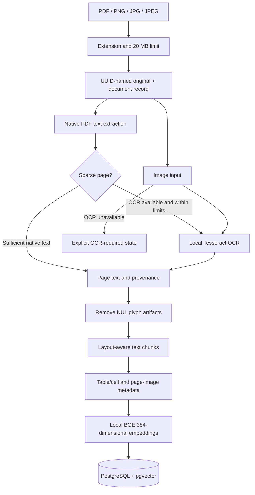
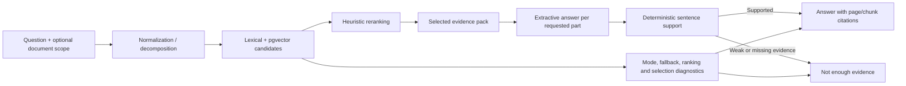

# System Overview

DocIntel AI is a single-user, local-first document intelligence application. The Next.js
workspace talks to FastAPI; PostgreSQL/pgvector persists evidence and evaluation history,
while originals remain in local file storage. Paid generation providers are optional.

## Components

| Boundary | Implementation | Responsibility |
| --- | --- | --- |
| Web | `apps/web/app`, `apps/web/components` | Uploads, workbench, search, study, source viewer, evaluation |
| Ingestion | `apps/api/app/documents` | Stream validation, storage, extraction/OCR, chunking, diagnostics, indexing |
| Retrieval | `apps/api/app/retrieval` | Query handling, vector/lexical search, heuristic reranking, evidence selection, extractive answers |
| Generation | `apps/api/app/llm`, `apps/api/app/study` | Local heuristic or optional Groq summaries/questions/feedback |
| Evaluation | `apps/api/app/evaluation` | Fixtures, source-reviewed cases, run lifecycle, diagnostics, scoped measurements |
| Data | `apps/api/app/db` | SQLAlchemy models, pgvector embeddings, additive local schema synchronization |

## Ingestion

Processing runs as FastAPI background work, not a distributed durable queue. Status,
errors, timing, and parse/OCR quality are exposed to the workspace. Text can be persisted
before embedding completes; failures remain visible rather than pretending indexing
succeeded. Reindexing rebuilds derived evidence and clears generated study artifacts.

NUL artifacts from PDF fonts/OCR are replaced with spaces before persistence because
PostgreSQL text cannot contain them. Original files and rendered images are unchanged.
This is not a general mathematical glyph repair system.

Table extraction is a native-text heuristic, not a full layout model. Cells retain source
associations when available. Page-image records track render metadata; preview images use
PyMuPDF/Pillow. No image-embedding search is implemented.

## Search and Verified Answers

`retrieval/service.py` is shared by Search and document benchmarks. It returns a response
and candidate/selected-evidence trace. Multi-part handling is heuristic decomposition and
evidence combination, not a general reasoning agent. Reranking is heuristic, not a trained
cross-encoder. BGE embeddings use 384-dimensional vectors and can run on CPU.

Verified Answers is extractive. Its verifier checks lexical overlap, numbers, entities,
and negation against source sentences. It can filter unsupported text and abstain, but
does not implement semantic entailment or prove factual correctness. Grounded text can
repeat a contradictory or incorrect source. Ranking/support scores are not calibrated
probabilities. Embedding failures produce explicit lexical-fallback diagnostics.

## Summaries and Study Sets

Generation uses selected evidence, filters noisy content, stores citations, and supports
preview before replacement. Summary modes are concise/detailed; question modes are
balanced/exam/simple revision. Saved learner answers have separate feedback and scores.

The default `LocalHeuristicLlmProvider` is deterministic/extractive, despite its interface
name. Optional `GroqLlmProvider` sends selected context, expected answers, or learner answers
to a hosted chat-completions service. Verified Answers itself does not use that provider.
Do not enable hosted generation for private material without permission.

## Reviewed Benchmarks

Suites contain versioned draft/reviewed cases. Positive labels require expected facts and
page/quote anchors; negatives require a scope rationale. Source hashes detect stale reviews.
Editing a label clears review; unchanged reindexing can resolve equivalent evidence even
when chunk IDs change. The editor exposes required fields and a prerequisite checklist.

Runs snapshot approved expectations and execute the shared search service. Results retain
answers, citations, candidates, selected evidence, fallback mode, latency, and failure reasons.
Cancellation occurs between cases; startup interrupts abandoned active runs. One active
benchmark run is permitted at a time. This is designed for one API process, not horizontal
multi-worker deployment.

Automatic measurements include numerators, denominators, and eligibility scopes. Untested
subsets are null, not 100%. Missing sources/provider failures do not inflate safe abstentions.
Human result assessments are separate. Historical expectations/results remain after live
cases or suites are changed/deleted. Polled run metadata updates the saved-run selector
without restarting the poller or discarding assessment edits.

See [Document Benchmarks](../testing/document-benchmarks.md) and
[the demo review checklist](../demo/review-checklist.md).

## Persistence and Trust Boundaries

- The named Docker volume holds records, vectors, and evaluation history.
- `DOCINTEL_STORAGE_DIR` holds originals. Keep database and files together; consistent
  absolute storage configuration avoids missing-source errors across checkouts.
- Startup performs additive local schema synchronization, not production migration/backup management.
- Files, model caches, and `.env` values are ignored by Git but are not encrypted by the app.
- There is no authentication/tenant isolation. Bind to loopback. CORS is not access control.
- First model initialization may contact Hugging Face to obtain weights. Default document
  processing does not send source context to a hosted LLM; Groq is opt-in.
- Demo services use `docintel_demo`, port 8001, separate storage, and an allowlisted loader.
  Personal uploads are not used to produce public screenshots or videos.

The [diagram source](system-overview.mmd) and [local development guide](local-development.md)
are maintained with this overview.
